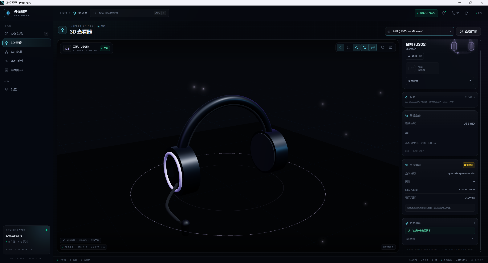

# Periphery · 外设视界

[简体中文](./README.md)

A Windows desktop viewer for **computer peripherals**: it turns the devices actually attached to your machine into a device overview, 3D models, a port topology, live telemetry and a desk layout, packaged as a Tauri 2 application.

The UI is built around a replaceable data source, so the same screens can display **real hardware scans**, be driven by a **Rust backend in the desktop app**, or fall back to **demo data** when no devices are available.

> Current version: `0.3.1`. All six pages, real device scanning, the Tauri desktop app and its installer are runnable. Vendor-specific telemetry, a precise glTF asset library and SQLite persistence are still on the roadmap — see [Known limitations](#known-limitations-and-roadmap).

## Preview



The 3D viewer: device list and canvas on the left, ports, connection state and power details on the right.

## Features

| Page | What it does |
| --- | --- |
| Device overview | Device cards, status filters, sorting, search, health summary, detail drawer |
| 3D viewer | Parametric models for 7 device categories (keyboard / mouse / headset / monitor / webcam / gamepad / microphone), port anchors, cables, camera controls |
| Port topology | Rebuilds the host → hub → device hierarchy from `LocationInfo`, laid out with elkjs |
| Live telemetry | ECharts series, metric switching, CSV export; unavailable readings are shown as *unavailable*, never guessed |
| Desk layout | Drag-and-drop placement, PNG / JSON export (exports carry a data-source label) |
| Settings | Chinese / English, theme, motion, data-source switching, snapshot loading |

Also included: command palette (`Ctrl+K`), `1`–`6` page shortcuts, toasts, a status-bar data-source badge and full zh/en i18n.

## Three data sources

The app selects a source in the order **Tauri → local scan snapshot → demo data**; Settings can switch back to demo data at any time.

| Mode | Source | Notes |
| --- | --- | --- |
| `tauri` | Rust backend calling Windows PowerShell PnP cmdlets | Default in the desktop app; 3-second polling diff emits `devices://changed` |
| `snapshot` | `public/real-devices.json` | Static snapshot generated by `npm run scan:devices` for browser use |
| `demo` | Built-in `DemoBackend` | Seeded pseudo-random data for demos and development |

**Data integrity rule**: collection is read-only. Battery level, DPI, polling rate and RGB values are left empty when they cannot be read — never filled with guesses. Simulated hot-plug and the synthetic telemetry ticker are disabled in real-data modes.

`public/real-devices.json` contains serial numbers and is git-ignored; it is never committed.

## Tech stack

| Layer | Choice |
| --- | --- |
| Desktop shell | Tauri 2, Rust (serde / anyhow / tracing / sha2) |
| Frontend | React 19, TypeScript, Vite 7, Tailwind CSS 4 |
| 3D / charts / topology | three.js + React Three Fiber + drei, ECharts, elkjs, xyflow |
| State / data | zustand (persist), TanStack Query, i18next, Radix UI, motion |
| Tooling | Biome (lint / format), Vitest, TypeScript `noEmit` |
| Device discovery | Windows `Get-PnpDevice` + PnP properties; optional Python `hidapi` for vendor / product / serial / usage page |

## Project layout

```
src/
  components/       Shared UI (layout / common / charts / ui)
  features/         Six feature pages (devices / viewer3d / topology / telemetry / layout / settings)
  hooks/            Device sync and data-source subscription
  lib/backend/      DemoBackend / TauriBackend / source state and snapshot loading
  lib/i18n.ts       Chinese and English strings
  stores/           zustand stores
  types/device.ts   Data contracts (DeviceSnapshot, PeripheralBackend, DataSource, ...)
src-tauri/
  src/device/       Windows PnP collection and device modelling
  src/topology.rs   Topology reconstruction
  src/diagnosis.rs  Diagnostics
  src/layout_store.rs Layout persistence
  src/lib.rs        Tauri commands and event emission
  src/main.rs       Desktop entry point
  icons/            Application icons
  tauri.conf.json   Window, CSP and bundler configuration
scripts/
  scan-devices.ps1  PowerShell collector (reused verbatim by Rust via include_str!)
  build-snapshot.py Generates the browser-side snapshot
public/             Static assets (favicon.svg; generated snapshot lives here)
```

## Getting started

### Prerequisites

- **Node.js ≥ 20.19** (required by Vite 7), npm
- **Real scans in the browser**: Windows + PowerShell, Python 3; optional `pip install hidapi` for extra HID fields
- **Desktop build**: Rust toolchain, a Windows C++ linker (MSVC Build Tools or MinGW-w64), and the [WebView2 Runtime](https://developer.microsoft.com/microsoft-edge/webview2/)

### Browser development

```bash
npm install
npm run dev          # http://127.0.0.1:1420/
npm run build        # production build into dist/
npm run preview      # preview the build output
```

The production build uses relative asset paths and can be served by any static host. `dist/` is git-ignored.

### Generate a real device snapshot

```bash
npm run scan:devices
```

The script invokes `scripts/scan-devices.ps1`, enumerates PnP devices, filters virtual audio endpoints, root hubs and all-zero placeholder serials, and writes `public/real-devices.json`. The status bar then shows **SCAN**. Switch back to demo data from the data-source section in Settings.

### Desktop app

```bash
npm run tauri -- dev
npm run tauri -- build --bundles nsis
```

- Dev mode starts `npm run dev` automatically on port 1420.
- The installer lands in `src-tauri/target/release/bundle/nsis/`; the binary is `src-tauri/target/release/peripheral-viewer.exe`.
- **Always build production binaries through the `tauri` CLI**: a plain `cargo build --release` produces a development-mode exe pointing at `127.0.0.1:1420`.
- If changes to `dist/` or `tauri.conf.json` are not picked up by `generate_context!`, run `cargo clean -p peripheral-viewer` before rebuilding.
- With the **GNU (MinGW-w64) toolchain**, `WebView2Loader.dll` must ship next to the exe. The DLL is included in this repository and wired into the installer via `bundle.resources`; copying only the exe will fail at startup.

### Checks

```bash
npm run lint        # Biome
npm run typecheck   # tsc --noEmit
npm test            # Vitest (frontend)
npm run test:probe  # probe rule unit tests (Python unittest)
npm run build
```

Current status: 0 lint errors, 0 type errors, 20 frontend tests + 17 probe tests passing, production build passing.

## Vendor battery probes

Battery level on 2.4 GHz peripherals travels over a vendor-private HID report. Windows' standard HID / PnP layer never sees it (no `0x85` Battery System Page, no battery-class device). This project handles that with **config-driven probes** instead of hard-coding one vendor's protocol:

- Config: `config/battery-probes.json` — the single maintenance entry point
- Engines: `scripts/battery_probe.py` (browser snapshot + calibration tooling), `src-tauri/src/battery.rs` (desktop)
- Both read **the same config**, so matching and decoding stay identical. Rust embeds it with `include_str!` at compile time, so rebuild the desktop app after editing.

### Two read strategies

| `transport.kind` | When it applies | Behaviour |
|---|---|---|
| `input-report` | Descriptor exposes only Input (e.g. Dareu 260D:1092) | Read-only `HidD_GetInputReport` per Report ID; never writes |
| `output-query` | Input and Output come in pairs (e.g. Rapoo 24AE:185A) | Sends the configured vendor query first, then reads the response; writes are off by default |

### Currently mapped

| Vendor | VID:PID | Strategy | Status |
|---|---|---|---|
| Dareu | `260D:1092` | `input-report`, Report ID 4 / 5, 24 bytes | **No readable battery channel** (measured 2026-11-08) |
| Rapoo | `24AE:185A` | `output-query`, Report ID 0xBA / 0xBB / 0xBC | **Calibrated** (single sample): Report 0xBC / 0xBB, offset 5, scale 1 |

Dareu is "the channel has no battery field", not "one byte left to identify". Three paths were ruled out by measurement: both vendor Input reports stayed completely static across 79 reads in 20 seconds (report 4 is all zeros, report 5 is `aa 01` plus a device string); the only 64-byte Feature report on the consumer-control interface is constantly `001601000300…`; and the descriptors expose no Output / Feature reports, so no query can be sent, with no `0x85` Battery System Page either. The UI therefore says "unavailable" with the reason instead of "pending calibration".

Rapoo evidence: with the vendor driver reporting 48%, the raw report was `b0 42 80 0c 01 30` and the last byte `0x30` is 48; when the level rose to 54% and 56% that byte became `0x36` and `0x38`, with both collections agreeing. Capture once more at a clearly different level to upgrade `confidence` from `single-sample` to `multi-sample`.

### Adding a vendor

1. Run `npm run scan:battery` to inspect HID interfaces, Usage Page and Report IDs.
2. Append an entry to `probes` in `config/battery-probes.json`: fill `match` (VID / PID / usagePage / usage) and `transport` (strategy, Report IDs, lengths), and set `decode.status` to `uncalibrated`.
3. Run `python scripts/battery_probe.py --validate`.
4. Calibrate and fill in `percentOffset`.

**No code changes required.** Only a genuinely new transport (for example BLE GATT) needs a new `transport.kind`.

### Calibrating

```bash
# Sample while the vendor driver shows X%
npm run battery:capture -- --reference 87 --label "vendor app shows 87%"
# Sample again after the level changes
npm run battery:capture -- --reference 63
# Get candidate byte offsets
npm run battery:suggest
```

`--suggest` prints candidate `percentOffset` / `percentScale`; put them into the probe's `decode` and switch `status` to `calibrated`. **Verify with a third level** before trusting a two-point fit.

### Safety and honesty rules

- **Read-only by default**: `defaults.allowDeviceWrites` is `false`; writes additionally require `--allow-write` on the command line and `transport.query.status=calibrated` — three independent gates.
- Uncalibrated, out-of-range, length-mismatched or failed reads always return "unavailable"; never a guessed or default value.
- Each HID read runs in its own subprocess with a hard timeout, so a blocking hidapi call cannot stall the whole scan.

## Maintenance notes

- **Do not add `manualChunks` rules casually.** `vite.config.ts` currently splits out only `elkjs` (which has no React dependency) and lets Rollup organise everything else, while page-level `React.lazy` splitting is kept. Splitting React / three / vendor into mutually dependent chunks creates a circular dependency that throws `Cannot read properties of undefined (reading 'useLayoutEffect')` and renders a blank (dark) screen.
- **The CSP must allow Tauri IPC.** `connect-src` in `tauri.conf.json` includes `ipc:` and `http://ipc.localhost`. Without them, commands such as `list_devices` are blocked by the browser: the UI renders but no device data arrives.
- **One collector, two consumers.** Rust embeds the same PowerShell script with `include_str!("../../../scripts/scan-devices.ps1")` that the Python snapshot generator uses; changes affect both sides.
- **Command contract.** The invokes in `src/lib/backend/tauri.ts` map one-to-one onto the commands in `src-tauri/src/lib.rs`; update both together.
- **Device category is not just the PnP class.** Combo 2.4G receivers enumerate both keyboard and mouse collections, so "has a Keyboard class → keyboard" misclassifies gaming mice (Rapoo 24AE:185A is exactly that). `scripts/device_category.py` and `src-tauri/src/device/hid.rs` decide by HID generic-desktop collection counts first, then by the usage of the lowest-numbered (primary) interface, and only fall back to name keywords when hidapi is unavailable. Keep both implementations in sync.

## Known limitations and roadmap

- Discovery relies on user-mode, read-only PnP interfaces — **no kernel driver**. Hot-plug detection uses polling diffs rather than `CM_Register_Notification`.
- Vendor protocols: a config-driven battery-probe framework exists; Rapoo's level is already calibrated, while the Dareu receiver was measured to expose **no readable battery channel** (see the previous section) — reading it would need BLE GATT or a vendor protocol capture. HID++ / OpenRGB and other protocols, real telemetry sampling, a precise glTF model library and device catalogue, and SQLite persistence/migrations are still unimplemented. 3D models are parametric models built per device category.
- Device categories rely on HID usage signals; without hidapi (Python `hidapi` module missing) combo receivers fall back to the keyboard-first name heuristic and may be misclassified again.
- The desktop build is not code-signed and has no auto-update or crash reporting.
- `elkjs` is ~1.44 MB and only loads when the topology page opens, but Vite still reports a chunk-size warning.
- Demo-mode topology uses a fixed device list, so devices created by simulated hot-plug do not appear in the graph.
- The desktop app depends on a system-installed [Evergreen WebView2 Runtime](https://developer.microsoft.com/microsoft-edge/webview2/).

## License

No open-source license has been specified yet.
