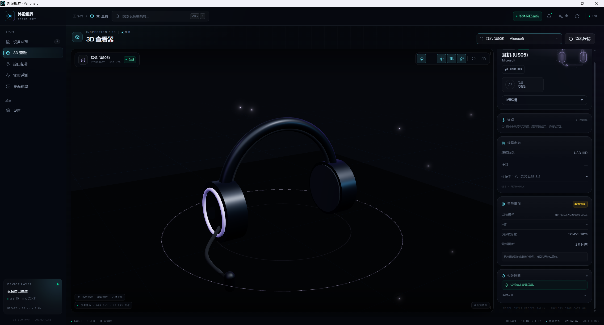

# 外设视界 · Periphery

[English](./README.en.md)

一个面向 Windows 的**电脑外设可视化查看器**：把本机真实外接设备整理成设备总览、3D 模型、端口拓扑、实时遥测与桌面布局，并提供 Tauri 2 桌面端。

项目采用「浏览器前端 + 可替换数据源」的结构：同一套 UI 既能加载**本机真实扫描数据**，也能在桌面端由 **Rust 后端实时采集**，还能在没有设备的环境用**演示数据**运行。

> 当前版本为 `0.3.1`。前端 6 个页面、真实设备采集、Tauri 桌面端与安装包均已可运行；厂商私有协议遥测、精确 glTF 资产库、SQLite 等仍属于后续规划，详见[已知限制](#已知限制与后续规划)。

## 界面预览



3D 查看器页面，左侧为设备列表与可视化画布，右侧是端口、连接状态与电源信息。

## 功能

| 页面 | 内容 |
| --- | --- |
| 设备总览 | 设备卡片、状态过滤、排序、搜索、健康概览、设备详情抽屉 |
| 3D 查看 | 基于参数的 7 类设备模型（键盘 / 鼠标 / 耳机 / 显示器 / 摄像头 / 手柄 / 麦克风）、接口锚点、线缆、视角控制 |
| 端口拓扑 | 按 `LocationInfo` 还原 host → hub → device 层级，elkjs 自动布局 |
| 实时遥测 | ECharts 曲线、指标切换、CSV 导出；读不到的字段显示「不可用」而非猜测值 |
| 桌面布局 | 拖拽摆放设备、PNG / JSON 导出（导出物带数据源标注） |
| 设置 | 中英双语、主题、动效、数据源切换、快照载入 |

其它：命令面板（`Ctrl+K`）、数字键 `1`–`6` 切页、Toast、状态栏数据源标签、中英 i18n。

## 三种数据源

应用按「Tauri 优先 → 本机扫描快照 → 演示数据」的顺序自动选择，设置页可切回演示数据。

| 模式 | 来源 | 说明 |
| --- | --- | --- |
| `tauri` | Rust 后端实时调用 PowerShell PnP 接口 | 桌面端默认；3 秒轮询 diff，变化时推送 `devices://changed` |
| `snapshot` | `public/real-devices.json` | 浏览器端由 `npm run scan:devices` 生成的静态快照 |
| `demo` | 内置 `DemoBackend` | 固定种子伪随机数据，用于演示与开发 |

**数据可信度约定**：所有采集只读；电量、DPI、回报率、RGB 等读不到就留空，绝不用猜测值填充；真实模式下禁用模拟热插拔与伪遥测 ticker。

`public/real-devices.json` 含设备序列号，已加入 `.gitignore`，不会提交到仓库。

## 技术栈

| 层 | 选型 |
| --- | --- |
| 桌面壳 | Tauri 2、Rust（serde / anyhow / tracing / sha2） |
| 前端 | React 19、TypeScript、Vite 7、Tailwind CSS 4 |
| 3D / 图表 / 拓扑 | three.js + React Three Fiber + drei、ECharts、elkjs、xyflow |
| 状态 / 数据 | zustand（persist）、TanStack Query、i18next、Radix UI、motion |
| 工程化 | Biome（lint / format）、Vitest、TypeScript `noEmit` |
| 设备采集 | Windows `Get-PnpDevice` + PnP 属性；可选 Python `hidapi` 补充厂商名 / 序列号 / usage page |

## 目录结构

```
src/
  components/       通用 UI（layout / common / charts / ui）
  features/         6 个功能页面（devices / viewer3d / topology / telemetry / layout / settings）
  hooks/            设备同步、数据源订阅
  lib/backend/      DemoBackend / TauriBackend / 数据源状态与快照加载
  lib/i18n.ts       中英文案
  stores/           zustand
  types/device.ts   数据契约（DeviceSnapshot、PeripheralBackend、DataSource…）
src-tauri/
  src/device/       Windows PnP 采集与设备建模
  src/topology.rs   拓扑还原
  src/diagnosis.rs  诊断
  src/layout_store.rs 布局持久化
  src/lib.rs        Tauri commands 与事件推送
  src/main.rs       桌面入口
  icons/            应用图标
  tauri.conf.json   窗口、CSP、打包配置
scripts/
  scan-devices.ps1  PowerShell 采集脚本（Rust 通过 include_str! 直接复用同一份）
  build-snapshot.py 生成浏览器端真实快照
public/             静态资源（favicon.svg；扫描快照生成于此）
```

## 快速开始

### 前提

- **Node.js ≥ 20.19**（Vite 7 要求）、npm
- **浏览器版真实扫描**：Windows + PowerShell，Python 3；可选 `pip install hidapi` 以补充 HID 属性
- **桌面端**：Rust 工具链、Windows C++ 链接器（MSVC Build Tools 或 MinGW-w64）、[WebView2 Runtime](https://developer.microsoft.com/microsoft-edge/webview2/)

### 浏览器开发

```bash
npm install
npm run dev          # http://127.0.0.1:1420/
npm run build        # 生产构建，输出到 dist/
npm run preview      # 预览构建产物
```

构建产物使用相对路径，可直接静态托管。`dist/` 已加入 `.gitignore`。

### 生成本机真实设备快照

```bash
npm run scan:devices
```

脚本调用 `scripts/scan-devices.ps1` 枚举 PnP 设备，过滤声卡虚拟端点、根集线器与全 0 占位序列号，输出 `public/real-devices.json`。打开应用后状态栏显示 **SCAN**；若要回到演示数据，在设置页的数据源区域切换。

### 桌面端

```bash
npm run tauri -- dev
npm run tauri -- build --bundles nsis
```

- 开发模式会自动启动 `npm run dev`（端口 1420）。
- 安装包输出到 `src-tauri/target/release/bundle/nsis/`，主程序在 `src-tauri/target/release/peripheral-viewer.exe`。
- **必须用 `tauri` CLI 构建生产版**：直接执行 `cargo build --release` 会生成指向 `127.0.0.1:1420` 的开发模式 exe。
- 修改 `dist/` 或 `tauri.conf.json` 后，若 `generate_context!` 未重新嵌入资源，先执行 `cargo clean -p peripheral-viewer` 再构建。
- 使用 **GNU（MinGW-w64）工具链**时，`WebView2Loader.dll` 必须随 exe 分发；仓库已内置该 DLL 并通过 `bundle.resources` 打进安装包。单独拷贝 exe 而不带 DLL 会启动失败。

### 校验

```bash
npm run lint        # Biome
npm run typecheck   # tsc --noEmit
npm test            # Vitest（前端）
npm run test:probe  # 电量探针规则单测（Python unittest）
npm run build
```

当前状态：lint 0 错误、typecheck 0 错误、36 个前端测试 + 42 个 Python 测试（设备分类 / 探针 / 校准覆盖层）+ 30 个 Rust 单测通过、生产构建通过。

## 厂商电量适配（Vendor battery probes）

2.4G 无线外设的电量走厂商私有 HID report，Windows 标准 HID / PnP 层读不到（没有 `0x85` Battery System Page、没有电池类设备）。本项目用**配置驱动的探针**处理，而不是把某家协议写死在代码里：

- 配置：`config/battery-probes.json` —— 唯一的维护入口
- 引擎：`scripts/battery_probe.py`（浏览器快照 + 校准工具）、`src-tauri/src/battery.rs`（桌面端）
- 两端读**同一份配置**，匹配与解码规则一致；Rust 通过 `include_str!` 在编译期嵌入，改完配置需重新构建桌面端。

### 两种读取方式

| `transport.kind` | 适用场景 | 行为 |
|---|---|---|
| `input-report` | 描述符只有 Input（如达尔优 260D:1092） | 按 Report ID 只读 `HidD_GetInputReport`，不写设备 |
| `output-query` | Input 与 Output 成对（如雷柏 24AE:185A） | 先发配置里的厂商查询命令再读响应；默认不写 |

### 当前已适配

| 厂商 | VID:PID | 方式 | 状态 |
|---|---|---|---|
| Dareu（达尔优） | `260D:1092` | `input-report`，Report ID 4 / 5，24 字节 | **无可读电量通道**（2026-11-08 实测） |
| Rapoo（雷柏） | `24AE:185A` | `output-query`，Report ID 0xBA / 0xBB / 0xBC | **已校准**（单点）：Report 0xBC / 0xBB 偏移 5，scale 1 |

达尔优这台是「通道里根本没有电量」，不是「差一个字节没认出来」。实测三条路径都排除了：两路 vendor Input report 在 20 秒内 79 次读取完全静态（report 4 全 0，report 5 是 `aa 01` + 设备串）；消费者接口唯一的 64 字节 Feature report 恒为 `001601000300…`；描述符里没有 Output / Feature，无法下发查询命令，也没有 `0x85` 电池用途页。因此界面显示「不可用」并给出原因，而不是「待校准」。

Rapoo 的校准依据：官方驱动显示 48% 时原始报告为 `b0 42 80 0c 01 30`，末字节 `0x30` = 48；后续电量升到 54%、56% 时该字节同步变为 `0x36`、`0x38`，两个 collection 读数一致。仍建议电量明显变化后再采一次，把 `confidence` 从 `single-sample` 升级为 `multi-sample`。

### 新增一个厂商

1. 运行 `npm run scan:battery`，确认本机 HID 接口、Usage Page 与 Report ID。
2. 在 `config/battery-probes.json` 的 `probes` 追加一项：填 `match`（VID / PID / usagePage / usage）、`transport`（读取方式、Report ID、长度），`decode.status` 先写 `uncalibrated`。
3. 运行 `python scripts/battery_probe.py --validate` 检查配置。
4. 按下面的流程校准并填 `percentOffset`。

**不需要改任何代码**。只有遇到新的读取方式（例如 BLE GATT）才需要扩展 `transport.kind`。

### 校准电量

```bash
# 厂商驱动显示 X% 时采样
npm run battery:capture -- --reference 87 --label "官方驱动显示 87%"
# 改变电量后再采一次
npm run battery:capture -- --reference 63
# 分析候选字节位置
npm run battery:suggest
```

`--suggest` 会输出候选的 `percentOffset` / `percentScale`，填入对应探针的 `decode` 并把 `status` 改为 `calibrated`。**建议再用第三个电量值验证一次**，避免只凭两点拟合误判。

### 校准覆盖层（运行时，不需重新编译）

内置 `config/battery-probes.json` 是编译期嵌入的只读基线；用户的校准结果写在
`%APPDATA%\peripheral-viewer\battery-calibration.json`，运行时合并、保存即生效：

| 层 | 位置 | 谁写 |
|---|---|---|
| L0 基线 | `config/battery-probes.json` | 随版本发布（只读） |
| L1 覆盖层 | `%APPDATA%\peripheral-viewer\battery-calibration.json` | 应用内校准 / 手工编辑 |

- 覆盖层**只能改 `decode`**（解码方式），`match` / `transport` 永远以基线为准——用户改错也变不出写通道。
- **序列号级校准**：同一探针可以针对具体设备单独校准（条目带 `serial`），优先生效；没有对应序列号时退回通用条目，同型号另一台不会被带偏。
- 整份文件校验失败时**整份忽略**并回到基线，同时在设置页给出错误原因；改动前会留一份 `.bak`。设置页支持**导出 / 导入**校准文件。
- 桌面端命令：`battery_channels` / `battery_sample` / `battery_calibration_state` / `battery_calibration_save` / `battery_calibration_reset` / `battery_calibration_export` / `battery_calibration_import` / `battery_scan_unmatched`。
- `scripts/battery_probe.py` 读同一份覆盖层，保证浏览器快照与桌面端结论一致。

> 界面内已有校准向导：设备详情抽屉里「待校准」下方点「电量校准」，或设置页「电量校准」区块点「打开校准向导」。流程为「选通道 → 填官方驱动显示的电量 → 只读采样（看字节表）→ 选候选 → 验证并保存」，保存后立即生效、可随时恢复内置。向导第 1 步还提供**未适配接口的只读扫描**，输出可直接提交的探针片段（默认 `enabled=false`，需随版本发布才生效）。设计见 [`docs/battery-calibration-plan.md`](docs/battery-calibration-plan.md)。

### 安全与诚实约定

- **默认只读**：`defaults.allowDeviceWrites` 为 `false`；写操作还需命令行 `--allow-write` 且 `transport.query.status=calibrated`，三重门控。
- 未校准、越界、长度不符、读取失败时一律返回「不可用」，绝不用猜测值或默认值填充。
- 每次 HID 读取在独立子进程中执行并设硬超时，避免 hidapi 同步调用卡住整个扫描。

## 维护注意事项

- **不要随意增加 `manualChunks` 规则**：`vite.config.ts` 目前只把不依赖 React 的 `elkjs` 单独拆出，其余交给 Rollup 自动组织（页面级 `React.lazy` 拆分保留）。把 React / three / vendor 拆成多个互相依赖的 chunk 会造成循环依赖，导致 `Cannot read properties of undefined (reading 'useLayoutEffect')` 并整页黑屏。
- **CSP 必须放行 Tauri IPC**：`tauri.conf.json` 的 `connect-src` 含 `ipc:` 与 `http://ipc.localhost`；缺少它们时 `list_devices` 等命令会被浏览器拒绝，页面能渲染但拿不到任何设备数据。
- **采集脚本是单一来源**：Rust 侧通过 `include_str!("../../../scripts/scan-devices.ps1")` 与 Python 快照脚本共用同一份 PowerShell 采集逻辑，修改时请同时考虑两端。
- **命令契约**：前端 `src/lib/backend/tauri.ts` 的 invoke 与 `src-tauri/src/lib.rs` 的 command 名称一一对应，改动需同步。
- **设备类别不能只看 PnP class**：组合式 2.4G 接收器会同时枚举出键盘和鼠标集合，只按「有 Keyboard 就判键盘」会把游戏鼠标误判成键盘（雷柏 24AE:185A 就是这样）。类别由 `scripts/device_category.py` / `src-tauri/src/device/hid.rs` 判定：先比 HID generic-desktop 集合数量，数量相同再看接口号最小的主接口用途；hidapi 不可用时才退回名称关键词。两端规则必须保持一致。

## 已知限制与后续规划

- 设备采集基于用户态 PnP 只读接口，**未接入内核驱动**；热插拔采用轮询 diff，而非 `CM_Register_Notification` 设备通知。
- 厂商私有协议：已提供配置驱动的电量探针框架；雷柏已校准出电量，达尔优该接收器经实测**不提供可读电量通道**（详见上一节），如需读取需改用蓝牙 GATT 或提供厂商协议抓包；HID++ / OpenRGB 等其余协议、真实遥测采样、精确 glTF 模型库与设备目录、SQLite 持久化与迁移仍未实现。3D 模型是按类别构造的参数化模型。
- 设备类别依赖 HID 用途信号；若 hidapi 不可用（缺少 Python `hidapi` 模块），组合接收器会退回「键盘优先」的名称启发式，可能再次误判。
- 桌面端尚未做代码签名、自动更新与崩溃上报。
- `elkjs` 约 1.44 MB，仅在打开拓扑页时按需加载，构建时仍会给出体积警告。
- 演示模式的拓扑图使用固定设备清单，模拟热插拔产生的设备不会入图。
- 桌面端依赖系统已安装的 WebView2 Runtime（[Evergreen](https://developer.microsoft.com/microsoft-edge/webview2/)）。

## 许可证

暂未指定开源许可证。
