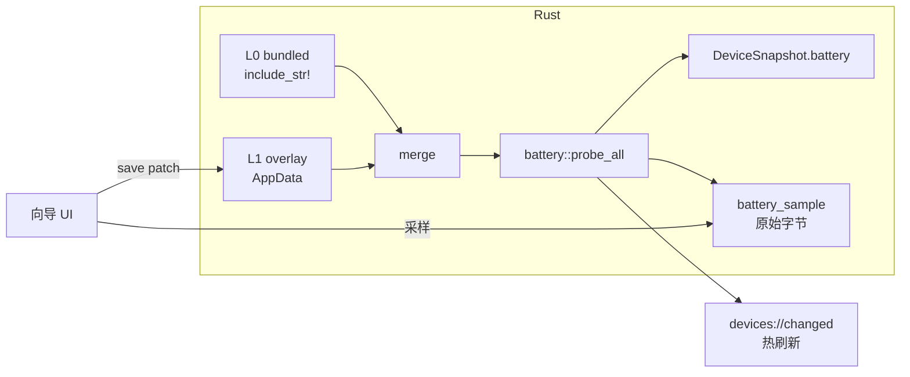

# 2.4G 设备电量 · 用户手动校准方案

> 版本：v1.0（设计稿）｜ 2026-11-13 ｜ 目标版本：v0.3.0
>
> 面向问题：现在只有开发者能校准（改 JSON + 跑 Python + 重新编译 Rust）。本方案让**最终用户不装 Python、不改代码、不重启应用**，在界面里完成一次 2.4G 外设电量校准，并且结果持久、可验证、可回滚。

---

## 1. 现状核查

### 1.1 已经跑通的部分

| 能力                                                  | 状态                                   | 证据                                                               |
| --------------------------------------------------- | ------------------------------------ | ---------------------------------------------------------------- |
| 6 页前端（总览 / 3D / 拓扑 / 遥测 / 布局 / 设置）+ 中英 i18n + 命令面板  | 完成                                   | `src/features/*`，20 个 Vitest 用例通过                                |
| Tauri 2 后端枚举（PowerShell PnP，`include_str!` 复用同一份脚本） | 完成                                   | `src-tauri/src/device/windows.rs`                                |
| 热插拔：3 秒轮询 + diff + 增量事件                             | 完成（非计划中的 `CM_Register_Notification`） | `lib.rs::start_watcher`                                          |
| 拓扑还原、诊断规则、布局 JSON 持久化                               | 完成                                   | `topology.rs` / `diagnosis.rs` / `layout_store.rs`               |
| 参数化 3D 模型（7 类）                                      | 完成（非 glTF 资产库）                       | `features/viewer3d/`                                             |
| 电量探针框架：配置驱动、双端一致、三重写门控、诚实空值                         | 完成                                   | `config/battery-probes.json` + `battery_probe.py` + `battery.rs` |
| 雷柏 `24AE:185A` 电量                                   | **可读**，单点校准                          | 快照实测 `battery=61`（Report 0xBC / offset 5 / scale 1）              |
| 达尔优 `260D:1092` 电量                                  | 判定为**通道无电量**（非待校准）                   | `channelAvailable: false` + 三条排除路径记录在配置里                         |
| 安装包                                                 | 完成（0.2.0 NSIS + 便携版）                 | `dist-desktop/`                                                  |

校验状态（本次实测）：`tsc --noEmit` 0 错误、`biome check` 68 文件无问题、Vitest 20/20、Python unittest 32/32、`battery_probe.py --validate` 通过。

### 1.2 与「技术栈方案」的偏差

| 方案章节                  | 规划                            | 实际                                         | 影响                            |
| --------------------- | ----------------------------- | ------------------------------------------ | ----------------------------- |
| 5.5 实时遥测 / 5.6 SQLite | 采样任务 + 环形缓冲 + 1 Hz 落库 + 7 天保留 | `get_telemetry_history` 恒返回空数组；布局用 JSON 文件 | 遥测页只能看电量快照，无历史曲线              |
| 5.1 热插拔               | `CM_Register_Notification`    | 3 秒轮询                                      | 延迟从 ≤800 ms 变 0–3 s，空闲 CPU 略高 |
| 5.2 / 5.3 资产          | glTF 模型库 + 型号目录               | 参数化模型，无设备目录                                | 视觉保真度低，但零资产成本                 |
| 4.4 协议                | HID++ / OpenRGB / Chroma      | 仅自研电量探针                                    | DPI / 回报率 / RGB 全部「不可用」       |
| 7 / 8                 | 代码签名、updater、Sentry、CI        | 均未做                                        | 发布阶段才需要                       |
| 平台适配层                 | macOS / Linux 适配器             | 只有 Windows                                 | 符合「Windows 首发」定位              |

### 1.3 电量校准链路的 7 个断点（本方案要解决的）

1. **配置是编译期嵌入的**：`battery.rs` 用 `include_str!` 把 `config/battery-probes.json` 打进二进制。用户改校准值 → 必须重新编译。这是「用户可校准」的硬阻断。
2. **校准工具在 Python 侧**：`npm run battery:capture` / `battery:suggest` 依赖 `pip install hidapi`。本机实测 `hidapi 未安装`，两个探针直接 `status=error`。让终端用户装 Python 不现实。
3. **无 UI**：用户看不到原始字节、看不到候选、也无法输入「官方驱动显示 87%」。
4. **无采样历史**：`--capture` 落到 `../temp/battery-captures/`（仓库外临时目录），应用内不可见、不可管理。
5. **置信度只存在于自由文本**：`maintenance.confidence` 是手写字符串，程序无法据此降级/提示。
6. **单点校准歧义无解**：`--suggest` 单点时把所有「字节值 == 参考值」的位置都算命中（雷柏 48% 时可能有多个字节同为 0x30），只能人工挑第一个。
7. **无法从 0 新增厂商**：用户换了一台未适配的设备，没有任何入口去探测并生成一条探针。

### 1.4 顺带发现的工程问题

- 工作区有 10 个文件未提交（README、config、battery_probe.py、battery.rs、DeviceDrawer、i18n、types 等），停在 0.2.0 提交之后。
- README 写「17 个探针测试」，实际 Python 测试 32 个（分类 15 + 探针 17）。
- 每次 3 秒轮询都会调用 `probe_all()` 重新打开 HID 通道读全部 Report ID（`windows.rs:488`），没有缓存与节流；设备多时是纯浪费。

---

## 2. 目标与非目标

**目标**

- 用户在当前设备上一路点完，就能把「不可用」变成「87%」，全程不离开应用。
- 校准结果写用户目录、立即生效、重启仍在。
- 校准质量可判断：单点 / 多点 / 已验证，分级展示，读不到就退回「不可用」。
- 全程只读设备，绝不因为校准而向设备写字节。
- 任何一步都不使用猜测值填充分辨率。

**非目标（本版不做）**

- 不做固件协议逆向工具（抓包、SetReport 自动枚举）。
- 不做云端共享库（先做本地导出/导入，社区汇总另议）。
- 不扩展到 BLE GATT（`transport.kind = ble` 留给后续，本方案只保证架构不挡路）。
- 不给 DPI / 回报率做校准（它们的编码模型不同，当前无真实数据支撑）。

---

## 3. 总体设计

### 3.1 三层配置

```
L0 bundled   config/battery-probes.json         编译期嵌入 · 只读 · 随版本升级
L1 overlay   %APPDATA%\Periphery\
             battery-calibration.json           运行时读写 · 用户校准结果
L2 draft     前端内存（向导会话）                不落盘，用户点「保存」才写 L1
```

合并优先级：`L2 > L1 > L0`。L0 保证开箱可用（雷柏已校准），L1 保证用户改了不丢，L2 保证「试一下不满意就撤销」。

### 3.2 合并规则（安全边界）

| 字段                                                                                                   | overlay 可否覆盖 | 理由                                 |
| ---------------------------------------------------------------------------------------------------- | ------------ | ---------------------------------- |
| `decode.status` / `percentReportId` / `percentOffset` / `percentScale` / `percentRange` / `charging` | ✅ 可          | 这些才是校准产物                           |
| `decode.samples[]` / `confidence` / `lastVerifiedAt`                                                 | ✅ 可（追加）      | 校准证据                               |
| `match.*`（VID / PID / usagePage / usage）                                                             | ❌ 禁止         | 改错会匹配到别的设备                         |
| `transport.*`（含 `query`、`bytesHex`、`writeRequired`）                                                  | ❌ 禁止         | **防止用户把只读通道变成写通道**；需要写能力时只能发版更新 L0 |
| `defaults.allowDeviceWrites`                                                                         | ❌ 禁止         | 同上                                 |

overlay 校验失败（JSON 坏、字段越界、引用了不存在的 probeId）→ **整份 overlay 忽略**，界面顶部显示「用户校准数据损坏，已回到内置配置」，并在设置页给出「导出损坏文件 / 重置」两个操作。绝不静默使用半份配置。

### 3.3 数据流



保存后**不重启进程**：重新 `probe_all()` + `apply_devices()` + emit，前端 300 ms 内看到新电量。

### 3.4 overlay 文件格式

```json
{
  "schemaVersion": 1,
  "updatedAt": 1763038331000,
  "entries": [
    {
      "probeId": "rapoo-2.4g-output-query",
      "serial": null,
      "decode": {
        "status": "calibrated",
        "percentReportId": 188,
        "percentOffset": 5,
        "percentScale": 1,
        "percentRange": [0, 100],
        "charging": null
      },
      "confidence": "single-sample",
      "samples": [
        { "reference": 48, "raw": "b042800c0130", "reportId": 188, "capturedAt": 1762517460000 }
      ],
      "calibratedAt": 1762517460000,
      "source": "wizard"
    }
  ]
}
```

- 时间统一用 Unix 毫秒（`i64`），避免为一个 ISO 字符串引入 chrono。
- `serial` 非空时表示「只对这台设备生效」，匹配优先级 `probeId+serial` > `probeId`。当前版本按 probeId 整体生效，按序列号细化留到 M3。
- 落盘用「临时文件 + 备份 + rename」原子写，并保留一份 `.bak`；写失败只提示，不改内存状态。

---

## 4. 校准算法

### 4.1 采样

- 对目标探针的每个 `reportId` 连续读 3 次，间隔 150 ms，单次硬超时 400 ms（沿用 `readTimeoutMs`）。
- 长度不一致 → 直接判「通道不稳定」，要求重采。
- 三次完全相等 → 标记 `static`。此时提示用户「**请按一下键盘 / 移动鼠标，让设备刷新一次再重采**」——很多 2.4G 接收器只在有事件时才更新报告（达尔优那台 20 秒 79 次读取完全静态就是这个现象）。

### 4.2 候选评估（每次采样后）

对每个 `(reportId, offset)` 组合，用「采样值 × scale ≈ 参考电量」拟合，`scale` 只允许 `{1, 0.5, 2, 1/2.55, 2.55}`（覆盖 0..100、0..200、0..255 三种常见编码），**不允许截距**（保持 decode 模型最小）。

打分维度：

| 维度        | 权重 | 说明                                        |
| --------- | -- | ----------------------------------------- |
| 多点残差      | 高  | 每个参考点的 |raw×scale − ref| ≤ 1 才算命中；残差越小分越高 |
| 参考点数量     | 高  | 1 点只能算候选，2 点起可信                           |
| 单调性       | 中  | 电量降序时该字节也应降（允许小幅抖动）                       |
| 字节语义排除    | 中  | 连续可打印 ASCII（设备串）、跨样本恒定、跨样本 0↔255 翻跳，降权或排除 |
| 报告 ID 一致性 | 低  | 同一探针多个 Report 命中时优先 `percentReportId` 默认值 |

输出前 3 名，每条带证据表：

```
候选 1  Report 188 · 偏移 5 · scale 1
        参考 48% → 0x30 (48)   参考 61% → 0x3D (61)
        残差 0 / 覆盖 0..100 / 未见 ASCII 特征
候选 2  Report 187 · 偏移 5 · scale 1
        （同一 collection 的镜像报告，读数一致；选 Report 188 更稳定）
```

**单点歧义的处理**：不再「取第一个命中」。如果单点有 ≥2 个候选，向导不直接给结论，而是把候选并排展示并说明差异，同时强烈建议「等你用掉 10% 电再回来采一次」。用户仍可强行保存，但置信度只能是 `single-sample`，界面电量旁显示「估算」标记。

### 4.3 解码与越界

保持现有语义不变：`value = raw[offset] × scale`，落在 `percentRange` 外 → `battery = null` + `status=error` + 「请重新校准」。连续 5 次越界（同一探针）自动把该条 overlay 降级为 `unverified` 并在设置页提示，避免长期显示错值。

---

## 5. 置信度模型

| 等级              | 条件                     | UI               |
| --------------- | ---------------------- | ---------------- |
| `unverified`    | 只有推断，无参考值              | 黄点「待验证」，电量显示但带 * |
| `single-sample` | 1 个参考值 + 用户确认保存        | 黄点「单点校准」         |
| `multi-sample`  | ≥2 个不同参考值，且全部残差 ≤1     | 绿点「多点校准」         |
| `verified`      | ≥3 个不同参考值，单调成立，跨度 ≥15% | 绿点「已验证」          |

升级只增不减的规则：新采样若与旧结论矛盾（残差 >1），不静默改数字，而是把 overlay 置为 `unverified` 并弹出「新采样与已有校准冲突，是否用新结论替换？」。

---

## 6. 交互流程

### 6.1 入口

1. **设备抽屉**：电量显示「待校准」且 `channelAvailable !== false` 时，兜底文案下方出现「校准电量」按钮（`DeviceDrawer.tsx:346` 附近）。
2. **设置页**：新增 `SectionCard「电量校准」`，列出所有命中的探针（含当前未接入设备的），显示状态、置信度、最后校准时间、`重置为内置`。
3. **未适配设备**：同一区块底部「新增厂商通道」，进入只读探测（见 6.3）。

### 6.2 向导（6 步）

| 步     | 内容                                                    | 异常分支                                                               |
| ----- | ----------------------------------------------------- | ------------------------------------------------------------------ |
| 1 通道  | 展示 VID:PID、usage page、transport kind、Report ID、通道是否可读 | `channelAvailable=false`（如达尔优）→ 直接终止，给出「改用蓝牙模式 / 提供抓包」两条建议，不提供死路按钮 |
| 2 参考值 | 滑块 + 数字输入 0–100，说明「请填厂商官方驱动此刻显示的电量」；可选「充电中」           | 无官方驱动 → 提示可用「跑到 5% 关机」做端点参考                                        |
| 3 采样  | 三次采样进度；显示原始字节表，跨样本变化的字节高亮                             | `static` → 提示先按键/移鼠标再采                                             |
| 4 候选  | Top 3 候选 + 证据表 + 「手动指定偏移」兜底输入                         | 无候选 → 提示可能是压缩编码/需先发查询命令，给出抓包指引                                     |
| 5 验证  | 用选中 decode 实时解码并展示结果，对比参考值；提示「10 分钟后电量变化再采一次可升级为多点」   | 解码值明显偏离 → 返回第 4 步                                                  |
| 6 保存  | 写入 overlay + 热生效 + Toast「已校准，当前 61%」                  | 写盘失败 → 保留草稿，提示路径与错误                                                |

关键点：**第 5 步必须先看到「解出来的数」再允许保存**，避免用户盲目点完存了个错映射。

### 6.3 新增厂商通道（只读探测）

给未适配设备一个「从 0 到 1」的入口：

1. 列出该设备所有 HID 接口（usage page ≠ 0001/000C/000D 的厂商自定义接口优先）；
2. 让用户选接口，逐个 Report ID 试读（只读 `get_input_report`，失败即跳过）；
3. 展示原始字节；用户填参考电量 → 走同一套候选算法；
4. 产出**可复制的探针片段 JSON**（`match` + `transport` + 未校准的 `decode`，`enabled=false`），由用户提交、随版本发布进 `config/battery-probes.json`。

为什么不是直接写进覆盖层：覆盖层按安全设计只能改 `decode`，不能新增 `transport`——否则「只读」承诺就失效了。首次适配必须走发版，这是有意的成本。

---

## 7. IPC 契约

```rust
// src-tauri/src/battery/：mod.rs（合并/解码/采样）+ config.rs（L0）+ calibration.rs（L1）

#[tauri::command]
fn battery_channels() -> Vec<BatteryChannel>;

#[tauri::command]
fn battery_sample(probe_id: String, times: Option<u8>) -> Result<BatterySampleResult, String>;

#[tauri::command]
fn battery_calibration_state() -> CalibrationState;

#[tauri::command]
fn battery_calibration_save(entry: OverlayEntry) -> Result<CalibrationState, String>;

#[tauri::command]
fn battery_calibration_reset(probe_id: String) -> Result<CalibrationState, String>;

#[tauri::command]
fn battery_calibration_export() -> Result<String, String>;   // JSON 文本

#[tauri::command]
fn battery_calibration_import(json: String) -> Result<CalibrationState, String>;
```

前端 `src/lib/backend/tauri.ts` 一一对应；`snapshot` / `demo` 模式下降级为「本机不支持校准，请用桌面端」，不伪造能力。

**热生效**：`battery_calibration_save` 成功后执行 `probe_all()` → `apply_devices()`，走现有的 `devices://changed` 推送，前端无需额外刷新逻辑。

---

## 8. 安全与诚实边界（不可妥协）

1. **校准全程只读**；向导里没有任何 `write` 调用。写能力仍由 L0 的 `query` + `allowDeviceWrites` + 命令级确认三重门控，且 overlay 无权开启。
2. **无值优于错值**：未校准 / 越界 / 读失败 → `null` + 原因，绝不用 0、50 或上次值顶替。
3. **overlay 校验在 Rust 侧做权威判断**，Python 侧镜像同一套规则（复用 `validate_config` 的字段约束），两侧测试用同一组 fixture。
4. **导出脱敏**：原始 hex 可能含设备串（达尔优 Report 5 就是 `aa 01` + ASCII 串），导出/上报前提示「包含设备标识，请确认后分享」，并默认截断非电量字节。
5. **可回滚**：任何时刻都能「重置为内置」，重置前自动备份到 `.bak`。

---

## 9. 实施计划

| 阶段            | 内容                                                                                                               | 交付物                                               | 规模      | 状态 |
| ------------- | ---------------------------------------------------------------------------------------------------------------- | ------------------------------------------------- | ------- | --- |
| **M1** 运行时覆盖层 | `battery/calibration.rs`（读写/校验/合并/原子写）、`battery_channels` / `battery_sample` / `battery_calibration_*` 命令、保存后热生效 | Rust 单测（合并、非法字段拒绝、原子写回滚）+ 手工验证「改 overlay → 不重启变值」 | 1–1.5 天 | 完成 |
| **M2** 向导 UI  | `lib/battery/calibrate.ts`（纯函数候选评分）、`features/calibration/CalibrationWizard.tsx`、设备抽屉入口、设置页区块、i18n 中英            | 评分模块单测（用雷柏 48%/61% 真实样本回归）+ 向导可用              | 2–3 天   | 完成（5 步） |
| **M3** 置信度与生态 | 置信度模型与降级、每设备 `serial` 覆盖、导出/导入、新增厂商通道探测、README 更新                                                                | 端到端验收通过                                           | 1–2 天   | 完成 |

### 验收标准

- [ ] 用户不装 Python、不改代码、不重启应用，可在向导内完成一次校准并看到电量。
- [ ] 重启应用后校准仍生效（overlay 持久化）。
- [ ] 非法校准（offset 越界 / scale ≤0 / probeId 不存在）保存被拒，错误信息指明具体字段。
- [ ] 全程零设备写入（可用 USBPcap 或代码审计确认无 `write` 调用路径）。
- [ ] 解码越界时显示「不可用 + 原因」，不显示猜测值。
- [ ] 评分模块对雷柏样本复现 `Report 188 / offset 5 / scale 1`。
- [ ] 达尔优那台在向导第 1 步即终止，并给出「蓝牙模式」「提供抓包」两条出路。
- [ ] 置信度从单点升级到多点的路径可走通（两次不同参考值）。

### 测试策略


- **Rust**：合并优先级、overlay 校验（逐字段非法值）、原子写失败回滚、decode 边界（offset == len、scale 极值、range 反序）。
- **TS**：`calibrate.ts` 纯函数——候选排序、ASCII 排除、单点歧义、scale 集合、两点矛盾检测。
- **Python**：`test_battery_probe.py` 增加 overlay 合并用例，保证 CLI 与桌面端结论一致（同一份 fixture 两边跑）。
- **手工矩阵**：雷柏（已校准，验证不破坏原有值）、达尔优（无通道，验证终止路径）、一台未适配设备（验证 6.3）。

---

## 10. 风险与对策

| 风险                      | 影响     | 对策                                         |
| ----------------------- | ------ | ------------------------------------------ |
| 单点校准选中错误字节              | 长期显示错值 | 多候选并排 + 强制二次验证 + 置信度标注 + 越界自动降级            |
| 报告是事件触发型，采样恒为静态         | 采不到有效值 | 第 3 步明确引导「先按键/移动鼠标」；连续 static 三次则建议改用多点/抓包 |
| 用户把 scale 配成 2.55 又选错字节 | 数值翻倍   | `percentRange` 校验 + 越界降级 + 第 5 步预览         |
| overlay 被手工改坏           | 全部电量消失 | 整份忽略 + 回到 L0 + `.bak` 可恢复                  |
| 同型号不同固件编码不一致            | 一台好一台错 | `serial` 级覆盖（M3）                           |
| 隐私：raw hex 含设备串         | 上报泄露标识 | 导出时提示 + 默认截断                               |

---

## 11. 与现有代码的衔接点

| 文件                                       | 改动                                                                              |
| ---------------------------------------- | ------------------------------------------------------------------------------- |
| `src-tauri/src/battery.rs`               | 拆为 `battery/{mod,probe,calibration}.rs`；`probe_all()` 读 L0+L1 合并结果              |
| `src-tauri/src/lib.rs`                   | 注册 7 个新命令；保存后触发 `probe_all` + `apply_devices`                                   |
| `src-tauri/src/device/windows.rs`        | `build_devices` 中的 `probe_all()` 增加结果缓存（建议 30 s TTL，或仅在 diff 命中电量设备时刷新）         |
| `src/types/device.ts`                    | 新增 `BatteryChannel` / `BatterySample` / `CalibrationPatch` / `CalibrationState` |
| `src/lib/backend/tauri.ts`               | 新命令的 invoke 封装；`PeripheralBackend` 增加可选校准能力                                     |
| `src/features/devices/DeviceDrawer.tsx`  | 「校准电量」入口                                                                        |
| `src/features/settings/SettingsPage.tsx` | 电量校准区块                                                                          |
| `src/lib/i18n.ts`                        | 向导文案（中英）                                                                        |
| `src/lib/battery/calibrate.ts`           | 新增，纯函数评分模块                                                                      |
| `README.md`                              | 校准章节改为「界面内完成」，CLI 保留为高级路径                                                       |

---

## 12. 建议的顺手清理

1. 先提交当前 10 个未提交文件，避免这轮改动和大改混在一起。
2. README 的测试数改为「20 前端 + 42 Python」。
3. `battery_probe.py` 在 `hid is None` 时给出明确的 `pip install hidapi` 提示（现在只在结果里说「未安装」），或直接引导用桌面端校准。
4. 轮询里的 `probe_all()` 加缓存（见上表），避免每 3 秒重开 HID 通道。

---

## 13. M1 实现记录（2026-11-13）

### 文件

| 文件 | 内容 |
|---|---|
| `src-tauri/src/battery/mod.rs` | 三层合并、15 s 电量缓存、`channels()`、`sample()`、`decode_reports()`、`payload_only()` |
| `src-tauri/src/battery/config.rs` | L0 解析（`include_str!` 随文件移动改为 `../../../config/...`） |
| `src-tauri/src/battery/calibration.rs` | L1 读写、逐字段校验、原子写 + `.bak`、导入导出 |
| `src-tauri/src/lib.rs` | 7 个命令；`refresh_after_calibration()` 保存后热推送；`has_changes()` 纳入电量签名 |
| `scripts/battery_probe.py` | 同一份 L1：`overlay_path()` / `read_overlay()` / `effective_decode()`，快照与桌面端结论一致 |
| `src/types/device.ts`、`src/lib/backend/tauri.ts` | IPC 类型与调用封装（浏览器 / 演示模式不提供，界面据此降级） |

### 顺带修掉的两个既有问题

1. **双端 Report 字节基准不一致（疑似错一位）**：hidapi 在 Windows 上要求把 Report ID 写进 `buf[0]`，成功后该字节被设备回填；而校准偏移（含雷柏 `offset 5`）是按「不含 Report ID 的 payload」标注的。不做归一化时，桌面端 `payload[5]` 会读到 `0x01`（约 1%），与快照的 61% 不符。新增 `payload_only()` 统一剥离；首字节不等于 Report ID 时原样返回（幂等，两种情况都安全）。**需在真机上确认一次**。
2. **电量变化不推送**：`has_changes()` 原来只比较 `id + status`，电量从 48 变 61 不会 emit，界面会一直显示旧值。现在比较 `(status, battery, probe.status, channelAvailable)`。
3. **每 3 秒重开 HID 通道**：`probe_all()` 加 15 s 缓存，校准保存时主动失效。

### 验证状态

- `tsc --noEmit` 通过；Biome 70 文件干净；Vitest 36 个用例通过（新增 16 个校准算法用例，含雷柏真实样本回归）。
- Python 42 个用例通过（新增 10 个覆盖层用例）。
- **Rust：`cargo check` 无警告，`cargo test --release --lib` 30/30 通过**（含 Report ID 剥离、覆盖层合并、越界拒绝、原子写回滚）。
- 剩余待办：`npm run tauri -- build --bundles nsis` 出安装包，并在真机上确认雷柏电量（验证 `payload_only` 那条修复）。

复现命令（工具链隔离在 `workspace/temp/rust`，不在系统 PATH）：

```bash
export CARGO_HOME=/c/Users/Z/Desktop/ai/ws/temp/rust/cargo
export RUSTUP_HOME=/c/Users/Z/Desktop/ai/ws/temp/rust/rustup
export PATH="$CARGO_HOME/bin:/c/Users/Z/Desktop/ai/ws/temp/mingw/mingw64/bin:$PATH"
cd src-tauri && CARGO_BUILD_JOBS=2 cargo test --release --lib
```
